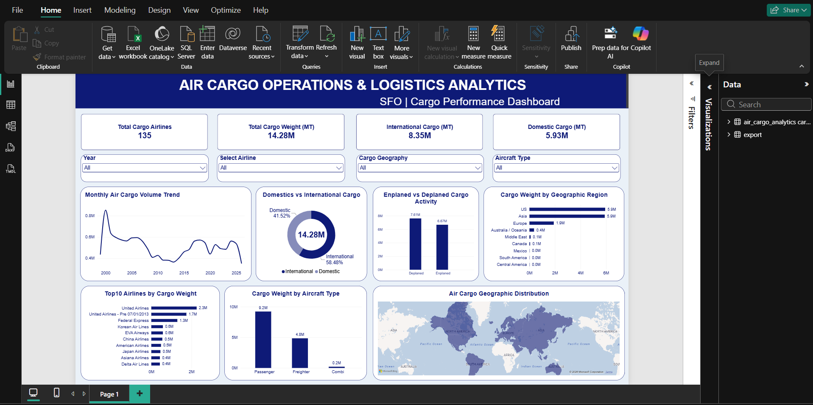

✈️ Air Cargo Operations & Logistics Analytics

📌 Project Overview

An end-to-end data analytics portfolio project analyzing air cargo operations at San Francisco International Airport (SFO). This project uses SQL, Power BI, and data visualization to identify cargo performance patterns, airline contributions, and geographic distribution.
## 📊 Power BI Dashboard Preview

🔍 Key Insights

- Analyzed total air cargo volume and cargo weight.
- Compared domestic and international cargo distribution.
- Identified top airlines by cargo weight.
- Examined monthly cargo trends.
- Analyzed cargo distribution by aircraft type.
- Explored geographic cargo movement patterns.
  
🎯 Business Objectives

- Analyze overall air cargo volume and operational activity.
- Identify top-performing cargo airlines.
- Compare domestic and international cargo distribution.
- Analyze cargo trends over time.
- Understand cargo distribution across aircraft types and geographic regions.

🛠️ Tools & Technologies

- **SQL / MySQL** – Data analysis and querying
- **Power BI** – Interactive dashboard development
- **Excel** – Data preparation and validation
- **GitHub** – Project documentation and portfolio hosting

📊 Dashboard Highlights

- Total Cargo Airlines KPI
- Total Cargo Weight KPI
- International Cargo KPI
- Domestic Cargo KPI
- Monthly Air Cargo Volume Trend
- Top 10 Airlines by Cargo Weight
- Domestic vs International Cargo
- Cargo Weight by Aircraft Type
- Cargo Weight by Geographic Region
- Enplaned vs Deplaned Cargo Activity
- Interactive slicers and geographic map

🔍 SQL Analysis

- Total cargo volume and average cargo weight.
- Airline performance ranking.
- Monthly and yearly cargo trends.
- Domestic vs international cargo comparison.
- Geographic region analysis.
- Cargo aircraft type analysis.

📂 SQL Project Files

[View SQL Analysis Queries](Air_Cargo_Analytics_Project/air_cargo_analytics.sql)

📈 Key Findings

- International cargo represents approximately 67% of cargo weight in the imported SQL dataset.
- Domestic cargo represents approximately 33%.
- Airline contributions vary significantly.
- Cargo volume differs across geographic regions and aircraft categories.

💡 Business Recommendations

- Monitor international and domestic cargo trends separately.
- Evaluate airline cargo contribution and operational activity.
- Use monthly trends to support capacity planning.
- Monitor aircraft type and geographic cargo distribution.

📁 Project Structure

Air_Cargo_Analytics_Project/
│
├── Air_Cargo_Analytics.sql
├── dataset/
│   └── export.csv
├── powerbi/
│   └── Air_Cargo_Dashboard.pbix
├── documentation/
│   └── Air_Cargo_Portfolio_Project.docx
├── screenshots/
│   └── dashboard.png
└── README.md

👩‍💻 Skills Demonstrated

- SQL Data Analysis
- Data Cleaning
- Exploratory Data Analysis
- KPI Development
- Power BI Dashboard Development
- Business Intelligence
- Data Visualization
- Business Insights Communication

🚀 Project Status

Completed SQL analysis and interactive Power BI dashboard development.

👩‍💻 Author

**Keerthana S.**  
Aspiring Data Analyst  
Skills: SQL | Power BI | Excel
